<p align="center">
  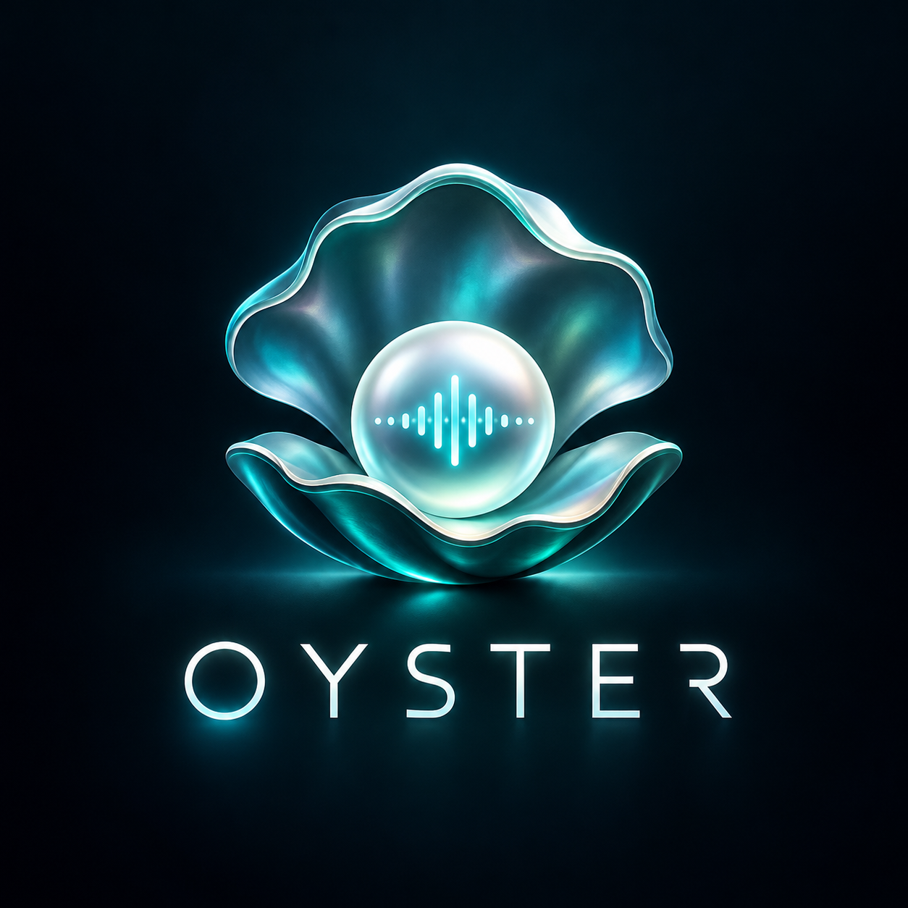
</p>
<p align="center">
  
</p>
<p align="center">
  <strong>Your music. Your sources. Your space.</strong><br>
  Free, open-source desktop music streaming. No ads. No tracking.<br>
  Windows · macOS · Linux
</p>
<p align="center">
  <a href="https://github.com/GalibDev/OYSTER-MUSIC/releases"></a>
  <a href="https://github.com/GalibDev/OYSTER-MUSIC/archive/refs/heads/master.zip"></a>
  <a href="LICENSE"></a>
</p>
<p align="center">
  <a href="#download--install">Download</a> · <a href="#features">Features</a> · <a href="#screenshots">Screenshots</a> · <a href="#run-from-source">Build</a> · <a href="packages/docs/README.md">Documentation</a>
</p>

## Download & install

**OYSTER installers have not been published yet.** Packaged downloads will appear on the [Releases page](https://github.com/GalibDev/OYSTER-MUSIC/releases). Until then, download the source and follow [Run from source](#run-from-source).

| Download | Link |
| :--- | :--- |
| App installers, when published | [OYSTER Releases](https://github.com/GalibDev/OYSTER-MUSIC/releases) |
| Current source code | [Download ZIP](https://github.com/GalibDev/OYSTER-MUSIC/archive/refs/heads/master.zip) |
| Build and release progress | [GitHub Actions](https://github.com/GalibDev/OYSTER-MUSIC/actions) |

### Installing a published release

1. Open [OYSTER Releases](https://github.com/GalibDev/OYSTER-MUSIC/releases) and select a release.
2. Expand **Assets** and download the file matching your operating system.
3. Follow the instructions below, then launch **OYSTER**.

| Platform | File to look for | Installation |
| :--- | :--- | :--- |
| Windows | `.exe` or `.msi` | Open the installer and follow the setup steps. |
| macOS | `.dmg` | Choose Apple Silicon or Intel for your Mac. Open the disk image and drag the app into Applications. |
| Linux | `.AppImage`, `.deb`, or `.rpm` | Make an AppImage executable and run it, or install the package with your distribution's package manager. |

Formats depend on the assets attached to each release. A source ZIP contains project files, not a ready-to-run installer.

## Features

| Listen & discover | Make it yours |
| :--- | :--- |
| Search tracks, artists, and albums | Create, import, and export playlists |
| Stream through plugin-provided sources | Save favorite tracks, albums, and artists |
| Follow synced and word-synced lyrics | Choose built-in and custom themes |
| Browse artist biographies and discographies | Reorder your queue, shuffle, and repeat |
| Explore listening history and statistics | Use keyboard shortcuts and multiple languages |

- **OYSTER Jam:** control playback and view lyrics from your phone on the same network.
- **Plugin store:** add streaming, metadata, lyrics, and discovery providers.
- **Integrations:** connect through the HTTP API, MCP server, or MPD protocol.

## Screenshots

<p align="center">
  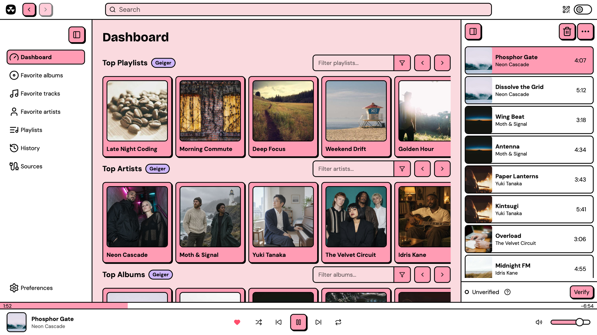
</p>

| Synced lyrics | Your playlists |
| :---: | :---: |
| 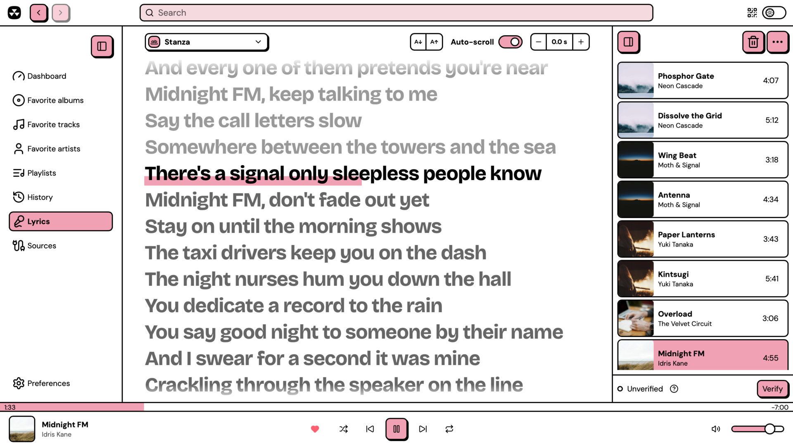 | 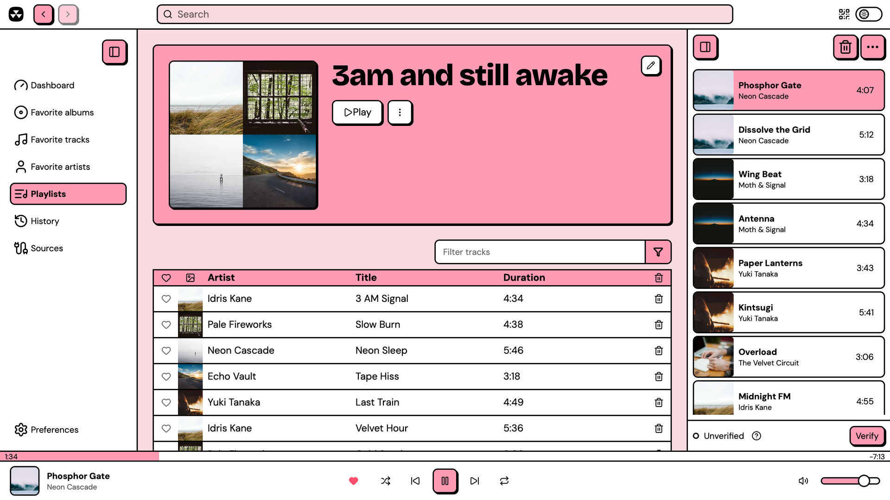 |

<details>
<summary><strong>Explore light and dark themes</strong></summary>

<p align="center">
  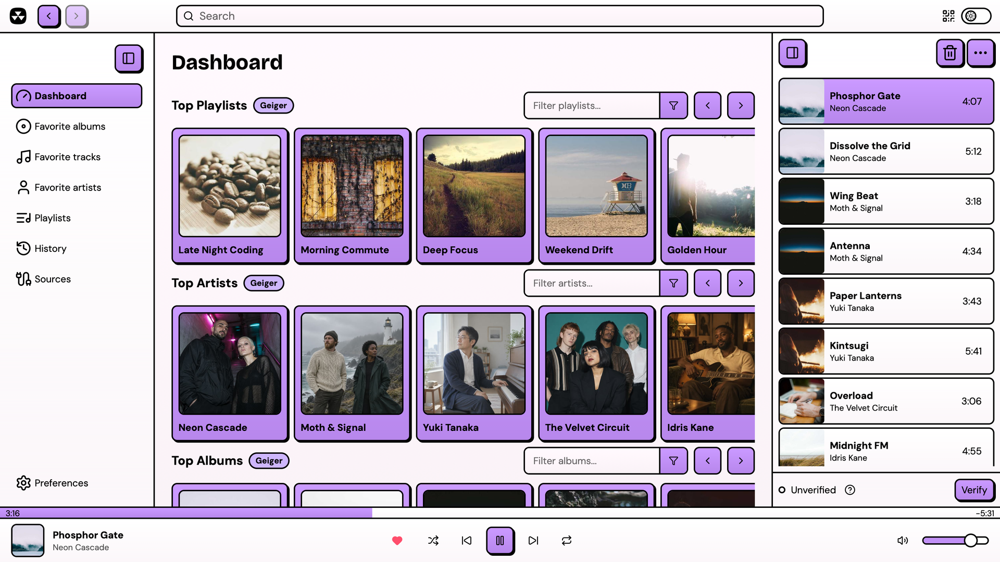
  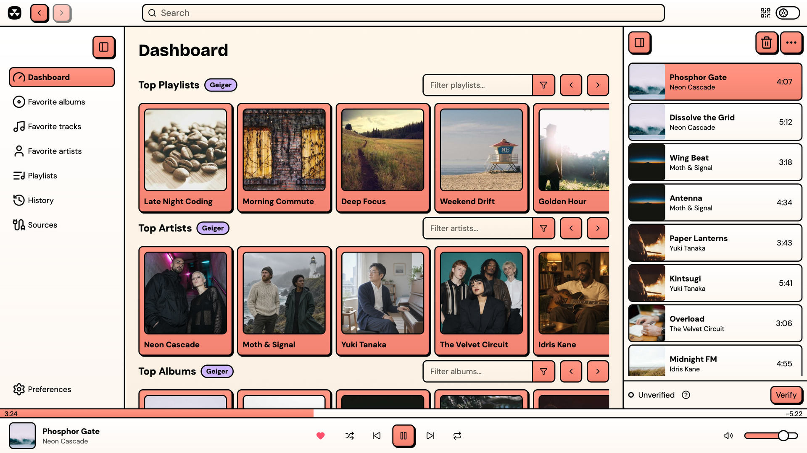
  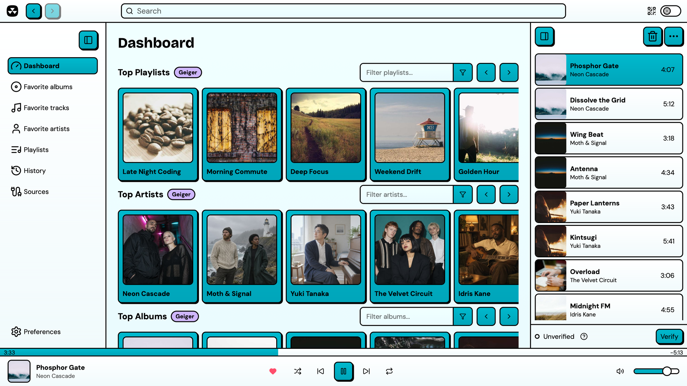
</p>
<p align="center">
  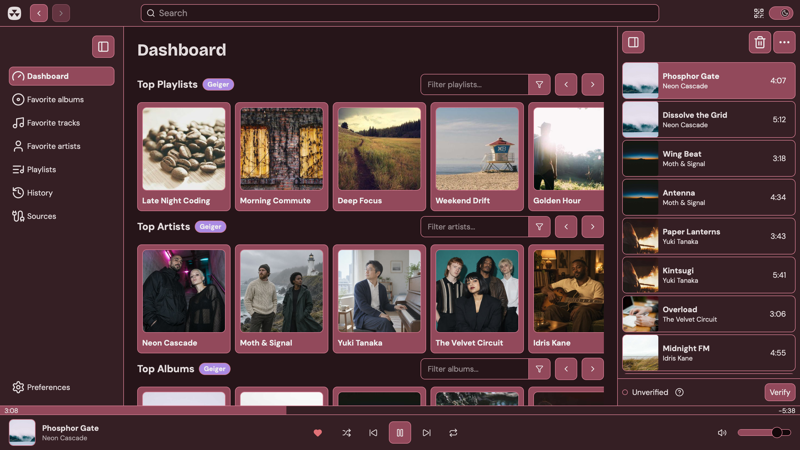
  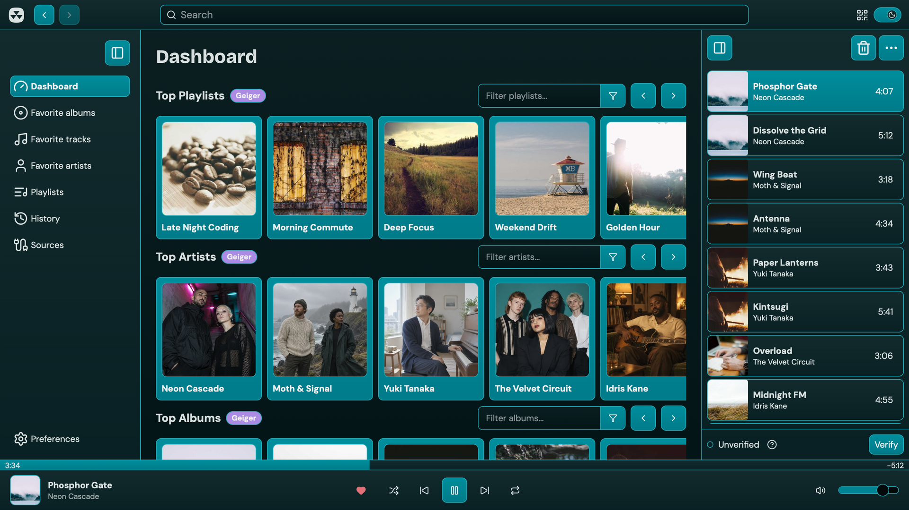
  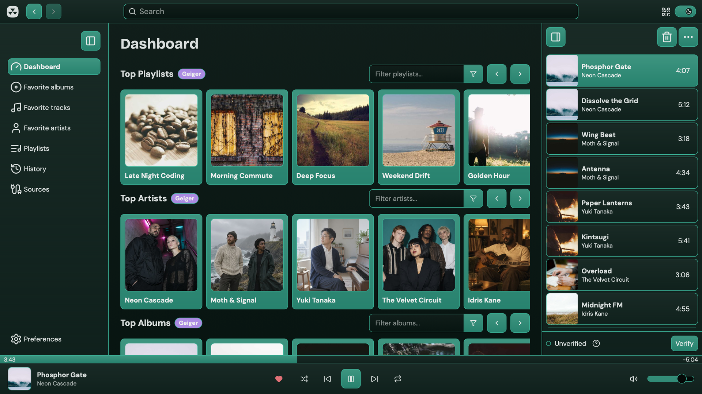
</p>

</details>

<details>
<summary><strong>Control playback from your phone</strong></summary>

Enable **OYSTER Jam** in **Settings → Integrations**, then open the displayed remote URL on a device connected to the same network.

<p align="center">
  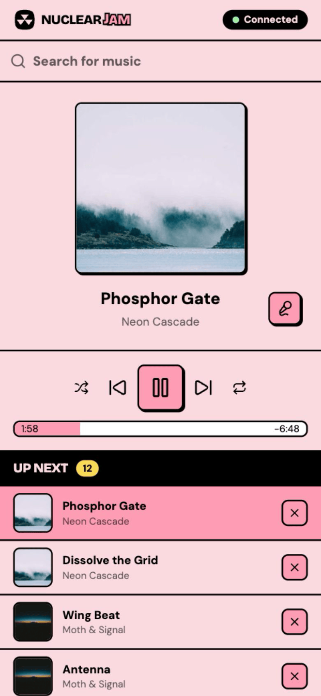
</p>

</details>

Screenshots show the underlying player interface and may include earlier branding.

## Run from source

### Prerequisites

- **Node.js 24** and **pnpm 12.0.0**, matching the repository's CI and package manager configuration.
- **Rust stable**, including Cargo.
- Your operating system's [Tauri prerequisites](https://v2.tauri.app/start/prerequisites/), including native build tools.
- Git, or the [source ZIP](https://github.com/GalibDev/OYSTER-MUSIC/archive/refs/heads/master.zip).

### Download and start

```bash
git clone https://github.com/GalibDev/OYSTER-MUSIC.git
cd OYSTER-MUSIC
pnpm install
pnpm dev
```

Using the ZIP? Extract it, open a terminal in the extracted project folder, then run `pnpm install` followed by `pnpm dev`.

The first run compiles the Rust desktop app and can take a while.

### Build an installer locally

```bash
pnpm --filter @nuclearplayer/player build
```

After a successful build, find your platform's installer in `packages/player/src-tauri/target/release/bundle/`. Local builds target your current operating system.

Internal `@nuclearplayer/*` package names are retained for workspace and plugin SDK compatibility.

### Development commands

| Command | Purpose |
| :--- | :--- |
| `pnpm dev` | Start the desktop app in development mode |
| `pnpm dev:remote` | Expose the development server to devices on your network |
| `pnpm test` | Run tests |
| `pnpm lint` | Run lint checks |
| `pnpm type-check` | Check TypeScript types |
| `pnpm storybook` | Explore UI components |

## Plugins & integrations

Install providers through the built-in plugin store to add music sources, lyrics, metadata, and recommendations. For plugin development, see the [plugin guide](packages/docs/plugins/getting-started.md) and [published SDK](https://www.npmjs.com/package/@nuclearplayer/plugin-sdk).

Enable the MCP server under **Settings → Integrations** and use the URL shown in Settings. The default is `http://127.0.0.1:8800/mcp`.

Read the guides for [MCP](packages/docs/integrations/mcp-server.md), [HTTP API](packages/docs/integrations/http-api.md), and [MPD](packages/docs/integrations/mpd-server.md).

## Contributing & support

[Open an issue](https://github.com/GalibDev/OYSTER-MUSIC/issues) to report a problem or suggest a feature. Include your operating system, steps to reproduce the problem, and relevant logs.

Read [CONTRIBUTING.md](CONTRIBUTING.md) before submitting changes.

## Credits & license

OYSTER is a customized fork of [Nuclear](https://github.com/nukeop/nuclear), created by nukeop and its contributors. This fork adds the OYSTER name and oyster-and-pearl visual identity.

Licensed under **AGPL-3.0-only**. See [LICENSE](LICENSE).
